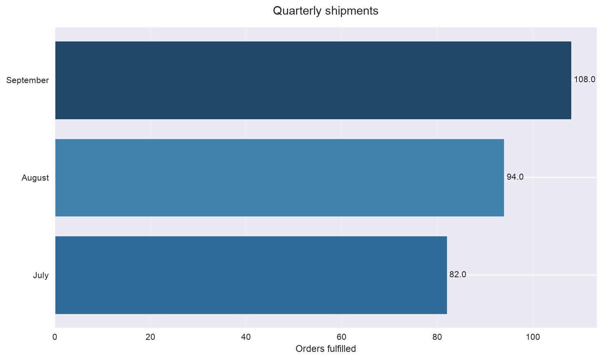

# MCP-OnlyOffice

Local Model Context Protocol (MCP) server for ONLYOFFICE Desktop Editors. Create DOCX, XLSX, PPTX, and PDF files, inspect Office documents, and work with an open editor from a compatible AI assistant.

The server uses stdio for MCP and a loopback WebSocket for the Desktop Editors plugin. See the [changelog](CHANGELOG.md) for the project history.

---

## Features

- **Document generation.** Create Office files, assemble DOCX/XLSX/PPTX report packs, embed images in DOCX reports, and generate charts and PDFs with the Python engine.
- **Document management.** Search local storage, analyze DOCX/XLSX/PPTX files, and validate OOXML structure and metadata.
- **Editor integration.** Open stored documents and send commands such as text insertion and find-and-replace through the Desktop Editors plugin.
- **Automation.** Run templates, workflows, batch creation, mail merge, and multi-step plans through the legacy profile.

### What changed

- **Tool profiles.** The default `legacy` profile registers 74 tools. The `professional` profile registers 20 focused document tools. Both publish MCP tool annotations. See the [profile reference](docs/TOOL_PROFILES.md).
- **Degraded startup.** Storage is the only fatal dependency. A missing editor or Python engine no longer stops the server; the `health` tool reports `core_ready`, `python_available`, `desktop_available`, `builder_available` and `document_server_available`, and the affected tools return a clear error.
- **Reports.** DOCX sections accept images. Report output names are sanitized and replacing an existing output requires `overwrite: true`.
- **Desktop pairing.** The plugin installs into the editor's GUID directory (override with `-plugin-dir`, `plugin_dir` config, or `MCP_ONLYOFFICE_PLUGIN_DIR`), discovers the loopback bridge, and reconnects automatically. The Linux audit exercised pairing and a DOCX editing and save round-trip in Desktop Editors. See [compatibility](docs/compatibility.md) for the tested version and remaining gaps.
- **Local file handling.** Filesystem paths are checked against configured roots, replacements use explicit overwrite flags and backups, and recursive deletion requires opt-in. ZIP processing enforces entry and size limits, and `delete_file` calls, overwrite backups, `append_text` calls, and skipped-symlink listings are recorded in a JSONL audit trail.
- **Python recovery.** Requests have correlated IDs, a size limit, and a 120-second timeout. A timed-out or canceled worker stops and restarts on demand. The caller receives an unknown-outcome error for the interrupted operation.

---

## Architecture

```
┌──────────────────────────────────────────────────────────┐
│                   AI Assistant (MCP Client)               │
│              OpenCode / Claude / Cursor                   │
└────────────────────────┬─────────────────────────────────┘
                         │ stdin/stdout (JSON-RPC over MCP)
                         ▼
┌──────────────────────────────────────────────────────────┐
│                  mcp-onlyoffice (Go binary)               │
│                                                          │
│  ┌─────────────────┐   ┌──────────────────────────┐     │
│  │  cmd/           │   │  internal/server/         │     │
│  │  main.go        │──▶│  - server.go (MCP)       │     │
│  │  (entry point)  │   │  - tools.go (74 tools)   │     │
│  └─────────────────┘   │  - *handlers.go          │     │
│                        │  - discovery.go (tiers)  │     │
│                        │  - cache.go              │     │
│                        └──────────┬──────────────-┘     │
│                                   │                     │
│  ┌────────────────────────────────┼──────────────────┐  │
│  │  internal/                      │                  │  │
│  │  ├── agent/     (document agent)│                 │  │
│  │  ├── planner/   (intent+plan)  │                 │  │
│  │  ├── workflow/  (workflows)    │                 │  │
│  │  ├── templates/ (templates)    │                 │  │
│  │  ├── analyzer/  (doc analysis) │                 │  │
│  │  ├── validator/ (doc validation│                 │  │
│  │  ├── ooxml/     (docx/xlsx/pptx│                 │  │
│  │  ├── storage/   (local storage)│                 │  │
│  │  ├── config/    (config loader)│                 │  │
│  │  └── desktoped/ (binary finder)│                 │  │
│  └────────────────────────────────┼──────────────────┘  │
│                                   │                     │
│  ┌──────────────────────────────┐ │                     │
│  │  internal/plugin/            │ │ WebSocket           │
│  │  bridge.go (client)          │◀┼────127.0.0.1:2021  │
│  │  index.go  (plugin files)   │ │                     │
│  └──────────────────────────────┘ │                     │
│                                   │                     │
│  ┌──────────────────────────────┐ │                     │
│  │  internal/engine/            │ │ stdin/stdout JSON   │
│  │  bridge.go (Go↔Python IPC)   │◀┼─────────────────┐  │
│  └──────────────────────────────┘ │                 │  │
│                                   │                 │  │
└───────────────────────────────────┼─────────────────┘  │
                                    │                     │
┌───────────────────────────────────┼─────────────────┐  │
│  python_engine/                   │ IPC              │  │
│  ├── runner.py   (IPC dispatcher) ◀──────────────────┘  │
│  ├── __init__.py (PythonEngine)  │                     │
│  ├── excel/       (spreadsheets) │                     │
│  ├── charts/      (matplotlib)   │                     │
│  ├── documents/   (python-docx)  │                     │
│  ├── presentations/ (pptx)       │                     │
│  ├── analytics/   (statistics)   │                     │
│  ├── pdf/         (fpdf2/pypdf) │                     │
│  └── images/      (Pillow)       │                     │
└──────────────────────────────────┘                     │
                                                         │
┌─────────────────────────────────────────────────────┐  │
│  ONLYOFFICE Desktop Editors (native app)             │  │
│  WebSocket plugin at ws://127.0.0.1:2021            │  │
└────────────────────────────────────────────────────-┘  │
                                                        │
┌─────────────────────────────────────────────────────┐  │
│  Document Storage (local filesystem)                 │  │
│  ~/mcp-onlyoffice/documents/ (default)               │  │
│  └── UUID payload + .metadata.json                     │  │
└─────────────────────────────────────────────────────┘  │
```

### Data Flow

1. **User sends natural language request** → AI model interprets and calls an MCP tool
2. **MCP protocol over stdin/stdout** → Go server receives the JSON-RPC request
3. **Go handlers** route to the appropriate subsystem:
   - Filesystem operations → direct Go I/O
   - Document creation → `internal/ooxml/` (raw XML+ZIP) OR `python_engine/` (via Go↔Python IPC)
   - Document editing → `internal/plugin/` WebSocket bridge to ONLYOFFICE Desktop
   - Complex tasks → `internal/planner/` → intent analysis → capability chain → execution
   - Document analysis/validation → `internal/analyzer/` + `internal/validator/`
4. **Response** → JSON-RPC result back to AI assistant

---

## Installation

### Prerequisites

| Dependency | Version | Purpose |
|-----------|---------|---------|
| Go | 1.25+ | Build core binary |
| Python | 3.14 (3.14.10 on this machine) | Document engine and its [pinned dependencies](python_engine/requirements.txt) |
| ONLYOFFICE Desktop Editors | 9.0.4.50 present on this machine; 8.x not tested here | Optional. Enables live editor commands; `health` reports `desktop_available`. See [compatibility](docs/compatibility.md). |

### From Source

```bash
git clone https://github.com/camilin7483/mcp-onlyoffice.git
cd mcp-onlyoffice
make build
python3 -m venv .venv
.venv/bin/python -m pip install -r python_engine/requirements.txt
./mcp-onlyoffice -help
```

Use the built binary in the checkout so it can find the adjacent `python_engine/` directory. The server uses `python3` from `PATH`. Configure your MCP client with the virtual environment on that path, as shown below.

### Configuration

The server uses built-in defaults and environment variables. For a JSON configuration, save a file such as `~/.config/mcp-onlyoffice/config.json` and pass it with `-config`. Environment variables override JSON settings.

```json
{
  "log_level": "info",
  "toolset": "professional"
}
```

| JSON field | Environment variable | Default |
|------------|----------------------|---------|
| `plugin_port` | `MCP_ONLYOFFICE_PLUGIN_PORT` | `2021` |
| `plugin_dir` | `MCP_ONLYOFFICE_PLUGIN_DIR` | Verified Linux default (`~/.local/share/onlyoffice/desktopeditors/sdkjs-plugins/<GUID>`); override with `-plugin-dir`, which wins over both |
| `storage_path` | `MCP_ONLYOFFICE_STORAGE_PATH` | `~/mcp-onlyoffice/documents` |
| `desktop_path` | `MCP_ONLYOFFICE_DESKTOP_PATH` | Auto-detected Desktop Editors binary |
| `log_level` | `MCP_ONLYOFFICE_LOG_LEVEL` | `info` |
| `allowed_roots` | `MCP_ONLYOFFICE_ALLOWED_ROOTS` | Effective storage directory |
| `builder_path` | `MCP_ONLYOFFICE_BUILDER_PATH` | Empty (disabled) |
| `toolset` | `MCP_ONLYOFFICE_TOOLSET` | `legacy` |

Set `allowed_roots` to an array of absolute directories or use a colon-separated list in the environment variable. Include the storage directory when setting custom roots if tools should access it. Python engine paths stay confined to the storage directory.

### OpenCode Configuration

Add this local server to your OpenCode 2 configuration. Replace the example paths with your checkout and virtual environment paths. See the [OpenCode MCP documentation](https://opencode.ai/docs/mcp-servers/#local).

```jsonc
{
  "mcp": {
    "servers": {
      "onlyoffice": {
        "type": "local",
        "command": ["/home/user/mcp-onlyoffice/mcp-onlyoffice"],
        "environment": {
          "PATH": "/home/user/mcp-onlyoffice/.venv/bin:{env:PATH}",
          "MCP_ONLYOFFICE_TOOLSET": "professional"
        }
      }
    }
  }
}
```

---

## Usage

The MCP client starts the server over stdin and stdout. For live editing, start the server once to install the plugin, then restart ONLYOFFICE Desktop Editors and open a document. The background plugin pairs with the server automatically.

### Quick Start Examples

Once connected, try these with your AI assistant:

| Request | What happens |
|---------|-------------|
| "Write meeting minutes to `meeting-minutes.docx` in my storage directory" | `write_docx` writes a DOCX with the supplied text |
| "Build a sales spreadsheet with these rows" | `write_spreadsheet` writes XLSX with headers and rows |
| "Create a presentation about Q3 results" | `write_presentation` writes PPTX with slides and tables |
| "Create a quarterly report in the reports folder under my storage directory and include this chart" | `create_report` generates a report pack and embeds the chart in the DOCX |
| "Analyze this stored document" | `analyze_document` inspects its structure |
| "Open this stored document in ONLYOFFICE" | `open_document` launches Desktop Editors |
| "Generate a bar chart from these figures" | `python_engine` runs `charts.bar_chart` in the legacy profile |

### Report images

Place the image in the configured storage directory and set `output_dir` to a subdirectory there. In a `create_report` call, add an image section with `path` (or `image`) and an optional `width_inches` from 0.5 to 12. The default is 6 inches.

```json
{
  "title": "Quarterly operations review",
  "output_dir": "/home/user/mcp-onlyoffice/documents/reports",
  "sections": [
    {
      "type": "image",
      "heading": "Quarterly shipments",
      "path": "quarterly-shipments.png",
      "width_inches": 5.5
    }
  ]
}
```

The Python engine generated this chart from fictional data and embedded it in a DOCX report.



---

## Tool Reference

These tables list selected legacy tools. The server registers the tools in the chosen profile at startup. See the [20 professional tools](docs/TOOL_PROFILES.md#professional-profile-20-tools).

### Tier 1 — Essential

| Tool | Description | Input |
|------|-------------|-------|
| `discover_tools` | Search tools by keyword | `query: string` |
| `load_tool_tier` | List tools through the selected tier | `tier: number (2\|3)` |
| `create_document` | Create doc in storage | `filename`, `content?` |
| `get_document` | Get doc by ID | `id` |
| `list_documents` | List all stored docs | — |
| `delete_document` | Delete doc by ID | `id` |
| `open_document` | Open in ONLYOFFICE Desktop | `id`, `mode? (edit\|view)` |
| `get_selected_text` | Get selected text in editor | — |
| `insert_text` | Insert at cursor | `text` |
| `replace_text` | Find and replace | `old`, `new` |
| `create_table` | Insert table | `rows?`, `cols?` |
| `create_list` | Insert list | `type (bullet\|numbered)`, `items[]` |
| `get_all_content` | Get full doc content | — |
| `write_document` | Write doc to filesystem | `path`, `content?` |
| `read_file` | Read file | `path` |
| `write_text` | Write text file | `path`, `content` |
| `append_text` | Append to file | `path`, `content` |
| `list_directory` | List directory | `path?` |
| `copy_file` | Copy file | `source`, `dest` |
| `move_file` | Move/rename | `source`, `dest` |
| `delete_file` | Delete file/dir | `path` |
| `file_info` | File metadata | `path` |
| `find_files` | Glob search | `pattern`, `root?` |
| `file_exists` | Check existence | `path` |
| `python_engine` | Run Python capability | `capability`, `params` |

### Tier 2 — Common

| Tool | Description |
|------|-------------|
| `create_word_document` | Create DOCX with title |
| `create_spreadsheet` | Create XLSX with sheet name |
| `create_presentation` | Create PPTX with title |
| `write_spreadsheet` | XLSX with headers+rows |
| `write_presentation` | PPTX with slides, tables, KPIs, themes |
| `write_docx` | DOCX with title+body |
| `write_table_docx` | DOCX with formatted table |
| `read_csv` | Parse CSV file |
| `write_csv` | Create CSV |
| `read_json` | Read and parse JSON |
| `write_json` | Write JSON object |
| `write_markdown` | Write MD file |
| `create_zip` | Archive files |
| `extract_zip` | Extract archive |
| `head_file` | First N lines |
| `tail_file` | Last N lines |
| `word_count` | Words/chars/lines |
| `checksum_file` | SHA-256 hash |
| `disk_usage` | Size/file/dir counts |
| `tree_directory` | Recursive listing |
| `csv_to_json` | Convert CSV to JSON |
| `json_to_csv` | Convert JSON to CSV |
| `touch_file` | Create empty file |
| `rename_document` | Rename stored doc |
| `copy_document` | Copy stored doc |
| `search_documents` | Search by filename |
| `export_document` | Export to filesystem |
| `import_document` | Import from filesystem |
| `storage_info` | Doc count + total size |
| `document_agent` | Create report with templates |
| `planner` | Plan+execute complex task |
| `list_capabilities` | List Python engine capabilities |
| `builder_render` | Convert/render a document via the optional Document Builder backend |
| `health` | Core and backend readiness as JSON |
| `document_operation` | Typed document mutation with dry-run, revision check, backup, receipt |
| `list_editor_sessions` | List connected editor sessions |

The professional profile registers 20 tools; the four above plus the
document, spreadsheet, presentation, report, analysis, validation, editor,
and `open_document` tools are listed in the
[profile reference](docs/TOOL_PROFILES.md#professional-profile-20-tools).

### Tier 3 — Advanced

| Tool | Description |
|------|-------------|
| `run_workflow` | Execute workflow |
| `list_workflows` | List available workflows |
| `list_templates` | List document templates |
| `render_template` | Render template with params |
| `analyze_document` | Analyze doc structure |
| `validate_document` | Validate OOXML structure |
| `add_document_reference` | Cross-reference documents |
| `get_document_references` | Get references |
| `create_report` | Create formatted business report (DOCX+XLSX+PPTX) |
| `operational_memory` | Performance stats + history |
| `discover` | Find capabilities by keyword |
| `self_improve` | Analyze + suggest improvements |
| `builder_render` | Convert/render via the optional Document Builder backend |
| `health` | Core and backend readiness as JSON |
| `document_operation` | Typed mutation with dry-run, revision check, backup, receipt |
| `list_editor_sessions` | List connected editor sessions |

---

## Python Engine Capabilities

The Python engine (`python_engine/`) provides these capability paths for the `python_engine` tool:

| Capability Path | Module | Features |
|----------------|--------|----------|
| `excel.create_workbook` | xl | Create workbook with sheets |
| `excel.insert_data` | xl | Insert rows/columns |
| `excel.kpi_sheet` | xl | KPI dashboard sheet |
| `excel.insert_formula` | xl | Insert a formula |
| `excel.conditional_format` | xl | Apply conditional formatting |
| `charts.embed_in_excel` | charts | Embed a chart image in a workbook |
| `charts.bar_chart` | charts | Bar chart with 150 DPI by default |
| `charts.line_chart` | charts | Line chart |
| `charts.pie_chart` | charts | Pie chart |
| `charts.heatmap` | charts | Heatmap |
| `charts.financial_chart` | charts | Financial chart |
| `documents.create_report` | docs | Report with python-docx |
| `presentations.create_deck` | pres | Slide deck with python-pptx (8-slide blue 16:9 theme + speaker notes) |
| `analytics.statistics` | analytics | Mean, median, standard deviation |
| `analytics.frequency` | analytics | Frequency distribution |
| `analytics.aggregate` | analytics | Group and aggregate |
| `pdf.create_pdf` | pdf | Generate PDF from text with cover page, pagination, and metadata |
| `images.convert` | images | Convert an image to another format |
| `images.resize` | images | Change image dimensions |

---

## Project Structure

```
mcp-onlyoffice/
├── cmd/
│   └── mcp-onlyoffice/
│       └── main.go              # Entry point
├── internal/
│   ├── agent/
│   │   └── agent.go             # Document agent orchestrator
│   ├── analyzer/
│   │   └── analyzer.go          # DOCX/XLSX/PPTX structure analyzer
│   ├── config/
│   │   └── config.go            # Configuration loader
│   ├── desktoped/
│   │   └── desktoped.go         # ONLYOFFICE Desktop binary finder
│   ├── engine/
│   │   └── bridge.go            # Go↔Python subprocess IPC bridge
│   ├── ooxml/
│   │   ├── ooxml.go             # OOXML shared helpers
│   │   ├── docx.go              # DOCX generator
│   │   ├── xlsx.go              # XLSX generator
│   │   ├── pptx.go              # PPTX generator
│   │   ├── csv.go               # CSV utilities
│   │   └── ooxml_test.go        # OOXML tests
│   ├── planner/
│   │   ├── planner.go           # Intent analysis + plan execution
│   │   ├── intent.go            # Intent classification (11 types)
│   │   ├── discovery.go         # Capability registry
│   │   ├── memory.go            # Operational memory + error recovery
│   │   ├── cache.go             # Plan cache (24h TTL)
│   │   ├── improvement.go       # Self-improvement suggestions
│   │   └── planner_test.go      # Planner tests
│   ├── plugin/
│   │   ├── bridge.go            # WebSocket client to ONLYOFFICE
│   │   └── index.go             # Plugin files installer
│   ├── server/
│   │   ├── server.go            # MCP server core
│   │   ├── tools.go              # 74 tool definitions
│   │   ├── doc_handlers.go      # Document creation handlers
│   │   ├── plugin_handlers.go   # Plugin interaction handlers
│   │   ├── engine_handlers.go   # Python engine + planner handlers
│   │   ├── fs_handlers.go       # Filesystem operation handlers
│   │   ├── storage_handlers.go  # Storage CRUD handlers
│   │   ├── agent_handlers.go    # Agent/workflow/template handlers
│   │   ├── discovery.go         # Tiered tool registry
│   │   ├── cache.go             # Session cache
│   │   └── result.go            # Response helpers
│   ├── storage/
│   │   ├── storage.go           # Storage interface
│   │   ├── local.go             # Local filesystem implementation
│   │   └── local_test.go        # Storage tests
│   ├── templates/
│   │   └── templates.go         # Document templates (4 types)
│   ├── validator/
│   │   └── validator.go         # OOXML structure validator
│   └── workflow/
│       └── workflow.go          # Workflow engine
├── python_engine/
│   ├── __init__.py              # PythonEngine class + dispatcher
│   ├── runner.py                # IPC stdin/stdout runner
│   ├── validator.py             # Result validation
│   ├── requirements.txt         # Python dependencies
│   ├── analytics/               # Statistics and analysis
│   ├── charts/                  # Chart generation (matplotlib)
│   ├── documents/               # Advanced document creation
│   ├── excel/                   # Spreadsheet operations
│   ├── images/                  # Image processing
│   ├── pdf/                     # PDF generation
│   └── presentations/           # Slide deck creation
├── documents/                   # Local document storage
├── config.example.json          # Example configuration
├── go.mod                       # Go module
├── go.sum                       # Go module checksums
├── Makefile                     # Build targets
├── install.sh                   # Installation script
├── uninstall.sh                 # Uninstallation script
├── update.sh                    # Update script
└── README.md                    # This file
```

---

## Development

### Building

```bash
make build        # Build binary
make clean        # Remove binary
make run          # Build + run
make dev          # go run (no build)
```

### Adding a New Tool

1. **Add handler** in `internal/server/` — create a `handleMyTool` method on `ToolHandlers`
2. **Register definition** in `internal/server/tools.go` — add a `toolDef` entry in `Definitions()`
3. **Add to tier** in `internal/server/discovery.go` — register in the appropriate tier (1/2/3)
4. **Restart server** — the tool is now available

Example minimal tool handler:

```go
func (h *ToolHandlers) handleMyTool(ctx context.Context, args map[string]any) (*mcp.CallToolResult, error) {
    name := args["name"].(string)
    result := fmt.Sprintf("Hello, %s!", name)
    return jsonResult(map[string]any{"message": result}), nil
}
```

### Adding Python Capabilities

1. Create a new directory `python_engine/your_module/`
2. Add a handler function that takes `params: dict` and returns a result dict
3. Register the engine module in `python_engine/__init__.py`

### Running Tests

```bash
go test ./...
go vet ./...
PATH="$(pwd)/.venv/bin:$PATH" python3 -m unittest discover -s python_engine
```

---

## Known Issues

- **Interactive editor commands.** Bridge pairing is covered by automated tests, but `get_selected_text` and `replace_text` against a live editor still need verification in an interactive Desktop Editors session.
- **Plugin install path.** Only the Linux plugins directory is built in. On other platforms pass `-plugin-dir` (or `plugin_dir` / `MCP_ONLYOFFICE_PLUGIN_DIR`); the server logs a warning and keeps serving when the plugin cannot be installed.
- **Plugin port discovery.** The bundled plugin scans ports 2021–2070. A custom port or random fallback outside that range requires a matching change to the plugin.
- **Document validation.** The OOXML validator checks ZIP/XML structure and metadata. Visual rendering can be checked in Desktop Editors.

## Benchmark

`make benchmark` runs the reproducibility bench (`cmd/bench`, full detail in
[docs/benchmark.md](docs/benchmark.md)). Latest run on this machine
(Linux amd64, i3-1215U, ONLYOFFICE 9.0.4.50, no builder binary):

- Validation: **0 errors on 5 fixtures**.
- Unrequested change rate: **0** (4 in-place samples; PPTX has no in-place
  editor and is skipped).
- Conflict detection: **1.0 on 200 cases**; rollback **1.0 on 67 attempts**
  (unknown-outcome reporting 1.0 on 33 attempts).
- 0 panics, 0 timeouts. All numbers are machine-specific; compare only
  identical hardware and software.

## Limitations (UNVERIFIED)

- Live editor commands in an interactive Desktop Editors session.
- Any specific MCP client app (only the go-sdk wiring in this repo was run).
- ONLYOFFICE 8.x on this tree (9.0.4.50 is what's installed here).
- Windows / macOS interactive use (cross-compiled and `go vet` only).
- `builder_render` against a real Document Builder binary (none present here).
- Real office open of generated files (the validator is structural).

See [docs/compatibility.md](docs/compatibility.md) for the full list.

## Further reading

- [Backends](docs/backends.md) — the four execution paths and tool mapping.
- [Transactions](docs/transactions.md) — operation lifecycle and receipts.
- [Benchmark](docs/benchmark.md) — metrics, environment, non-goals.
- [Compatibility](docs/compatibility.md) — tested vs UNVERIFIED.
- [Prior art](docs/prior-art.md) — related projects; no code copied.
- [Threat model](docs/threat-model.md) and [security](docs/security.md) —
  as-implemented guarantees and gaps.

## Troubleshooting

| Problem | Solution |
|---------|----------|
| Server binary missing | Run `make build` in the checkout and use its absolute path in the client config. |
| Desktop Editors binary missing | Install ONLYOFFICE Desktop Editors or set `desktop_path` to the installed binary. |
| Python engine unavailable | Keep `python_engine/` beside the Go binary and put the virtual environment on the client's `PATH`. |
| Desktop plugin disconnected | Start the MCP server, restart Desktop Editors, and open a document. Confirm the bridge is listening within ports 2021–2070. |

---

## Credits

**Author**: CamiloDev  
**Original creator**: Siddharth Ahuja (@ahujasid) — original Blender MCP architecture inspired this project's IPC approach  
**Tech**: Go 1.25 + Python 3 + MCP SDK + ONLYOFFICE  

## License

MIT — See [LICENSE](LICENSE) for details.
